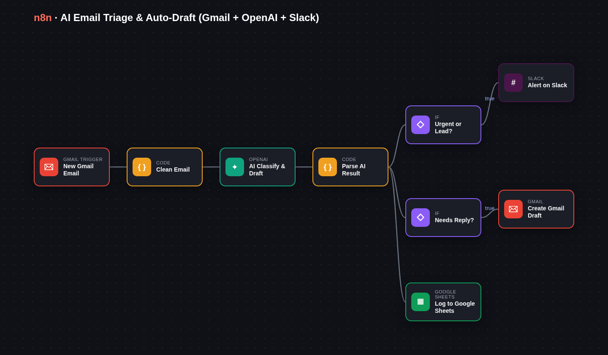
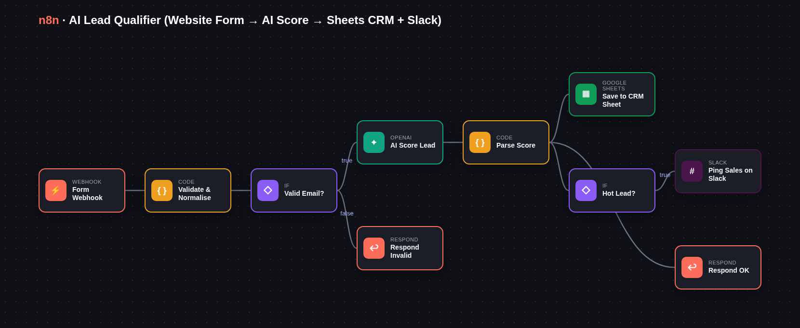
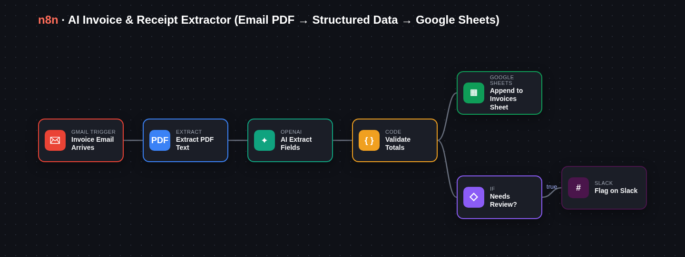

# n8n AI Automation Pack

Three **production-ready n8n workflows** that use AI to remove repetitive business work. You import them, connect your accounts and they're running.

> Open-source demo project by [Saad Rupai](https://github.com/saadrupai), a backend engineer who builds AI automations, billing systems and APIs.

| Workflow | What it does | Saves |
|---|---|---|
| **AI Email Triage & Auto-Draft** | Reads new Gmail, classifies it (lead / support / billing / spam), drafts a reply, alerts Slack for urgent emails and leads, and logs everything to Google Sheets | 1–2 h/day of inbox work |
| **AI Lead Qualifier** | Website form → validates input → AI scores the lead 0–100 (BANT) → saves it to a Sheets CRM → pings sales on Slack for hot leads | Instant follow-up on the best leads |
| **AI Invoice & Receipt Extractor** | Invoice PDF arrives by email → text extracted → AI pulls vendor, dates, line items and totals → math is validated → saved to Sheets, with mismatches flagged on Slack | Manual bookkeeping data entry |

---

### 1. AI Email Triage & Auto-Draft


### 2. AI Lead Qualifier


### 3. AI Invoice & Receipt Extractor


---

## What makes these production-grade

Most n8n templates are happy-path demos. These are built the way backend systems are built:

- **Strict JSON output.** The AI is forced into `response_format: json_object` with a fixed schema, and every response is parsed defensively. Bad AI output degrades to a safe default and never crashes the run.
- **Validation before AI.** Junk form submissions are rejected (HTTP 400) before any tokens are spent.
- **Guardrails on AI answers.** Unknown categories fall back to `other`, scores are clamped to 0–100, and invoice totals are re-checked with math (`subtotal + tax = total`, line items = subtotal). Anything inconsistent is flagged for a human.
- **Retries and timeouts** on every AI call (3 tries with backoff).
- **No made-up facts.** Prompts tell the model never to invent prices, dates or numbers.
- **Tested.** Unit tests cover the JavaScript in every Code node, and an end-to-end test runs a workflow inside a real n8n container against a mock AI server.

## Setup (about 10 minutes)

1. In n8n, go to **Workflows → Import from File** and pick a JSON file from `workflows/`.
2. Create credentials: **OpenAI**, **Gmail OAuth2**, **Google Sheets OAuth2** and **Slack**, then select them on the nodes marked with a warning.
3. Replace `REPLACE_WITH_SHEET_ID` with your Google Sheet ID. Create tabs named `Email Log`, `Leads` and `Invoices`, using the column headers shown in each Sheets node.
4. Set your Slack channels (`#inbox-alerts`, `#sales`, `#finance`) or change them to your own.
5. Activate the workflow.

**Changing the AI model or provider:** the model is set in each "AI …" HTTP node (`gpt-4o-mini` by default). Any OpenAI-compatible API works, including OpenRouter, Groq and Azure OpenAI; just change the URL.

**Lead form example:**
```bash
curl -X POST https://YOUR-N8N/webhook/lead -H 'Content-Type: application/json' \
  -d '{"name":"Jane","email":"jane@acme.io","company":"Acme","budget":"$5k","message":"Need an AI support bot"}'
```

## Tests

```bash
node --test test/code-nodes.test.mjs   # unit tests for Code-node logic (no n8n needed)
./test/run_e2e.sh                      # real n8n in Docker + mock OpenAI, fires webhook requests
```

## Want this for your business?

I build custom AI automations with n8n, Make, Zapier or plain code: inbox triage, lead routing, document extraction, CRM sync and AI agents. You can reach me on [Fiverr](https://www.fiverr.com/saadrupai69).

MIT License
